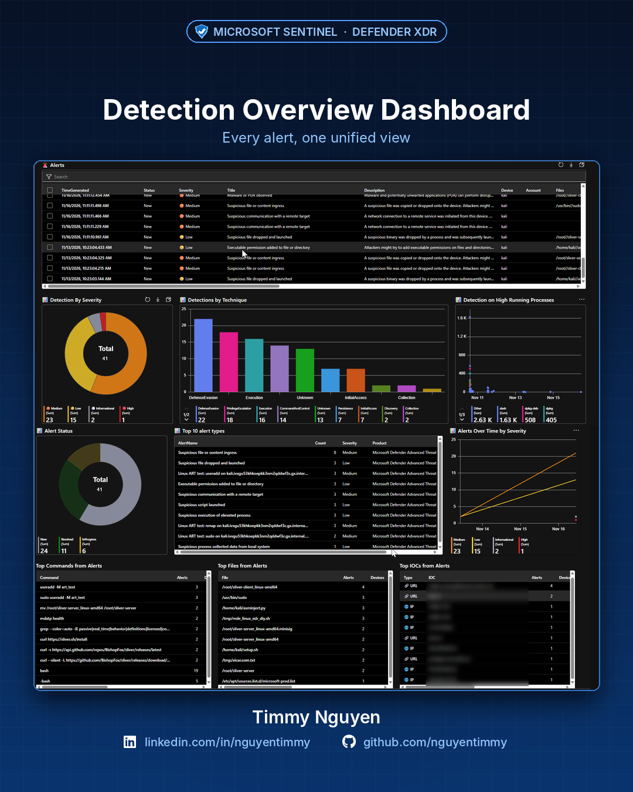
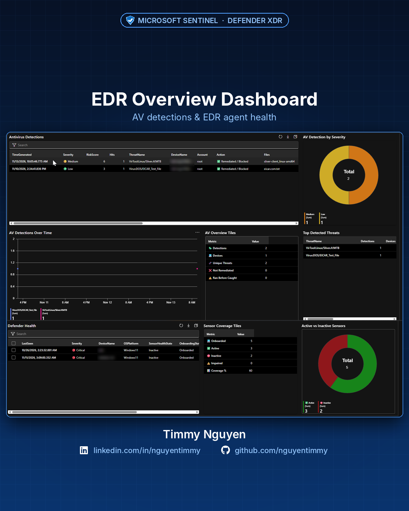

# 🛡️ Detection Engineering & Threat Hunting

A library of KQL detection rules, threat hunting queries, Sentinel/Defender workbooks and SOAR playbooks built to detect and respond to real-world attacks in enterprise environments.

---

## 🎯 About

Detection engineering and threat hunting content for Microsoft Sentinel and Microsoft Defender XDR, focused on threats actively targeting enterprise environments: identity attacks, EDR evasion, living-off-the-land techniques, data exfiltration, and AI-driven autonomous attacks.

Everything is built and tested in an Azure homelab (Windows and Linux endpoints onboarded to Defender and Sentinel) against simulated attacker activity before being published.

---

## 🔍 What's Inside

### ⚡ Custom Detection Rules
> Analytics rules for Sentinel and Defender XDR: high-fidelity detections with tuned false-positive rates, entity mapping and response guidance.

### 🎯 Threat Hunting Queries
> Proactive queries to hunt for suspicious activity across the environment:
- **🧱 EDR & Defense Evasion:** BYOVD, ASR bypass, Defender tampering
- **🔑 Identity Attacks:** password spray, MFA fatigue, impossible travel, risky sign-ins
- **📤 Data Exfiltration:** sensitive file downloads, mass OneDrive/SharePoint access
- **🪤 Living-Off-the-Land:** PowerShell abuse, LOLBin misuse, obfuscated commands
- **🤖 AI & Autonomous Attacks:** LLM API misuse, offensive AI tooling, machine-speed discovery, scanning and sign-in spraying
- **➕ More**

---

## ⚖️ Detection Rules vs Threat Hunts

Both are needed. They solve different problems.

| | 🚨 Detection Rules | 🔍 Threat Hunts |
| --- | --- | --- |
| **Fires as** | Scheduled alert | Workbook query |
| **Precision** | High: one match = act | Moderate: needs analyst context |
| **Purpose** | Catch known-bad patterns automatically | Find what no one has written a signature for yet |
| **Response** | Immediate, often automated | Review, tune and pivot |
| **Examples** | Break-glass account use, sign-in from IOC, honeytoken use | Suspicious PowerShell scoring, LOLBin abuse, machine-speed discovery |

- **Detection rules** pinpoint known-bad activity and demand attention the moment they fire.
- **Threat hunts** surface the noisier activity, finding what automation misses and techniques that slip past existing detections.

---

## 📊 Workbooks & Dashboards

| Workbook | Purpose | When to use |
| --- | --- | --- |
| **🖥️ Security Operations** | Detection Dashboard, EDR Dashboard (AV detections, EDR evasions, Defender health, ASR blocks vs audits), KPI Metrics, Threat Hunting, SIEM Dashboard (ingestion, connector and rule health) and Incident Response Dashboard (risk-scored device, user and data exfil timelines) | Daily/weekly proactive review |
| **🎯 Threat Hunting** | Daily Hunts for known attacker techniques, plus AI & Autonomous Threats for LLM misuse and machine-speed attacks | Start of shift, proactive hunting |
| **🔎 Digital Forensics** | Device-scoped timelines: process lineage, file/registry/network activity, persistence inventory | Post-incident deep investigation |

> ⚠️ Workbooks do not replace alert triage. Alerts and incidents should still be investigated; the workbooks support deeper investigation.

---

## 🤖 SOAR Playbooks

| Playbook | What it does |
| --- | --- |
| **🍯 Honeytoken Isolation** | Contains any device, account or IP that touches a decoy: collects evidence, isolates the device, disables real users and blocks external IPs, with Teams approval for protected assets |
| **📧 Malicious Sender Blocking** | Blocks malicious senders through the Tenant Allow/Block List using Microsoft Graph |
| **➕ More coming** | Session revocation, IOC block list management |

---

## 🛠️ Tools & Platforms

- Microsoft Sentinel
- Microsoft Defender XDR (Endpoint, Identity, Office 365, Cloud Apps)
- KQL (Kusto Query Language)
- Azure Logic Apps and Microsoft Graph API

---

## 📚 Standards & Conventions

- **🧪 Lab-validated:** every query is tested against simulated activity in the Azure homelab
- **🎛️ Parameterized:** time range and device/user filters on all workbooks
- **🔴 Severity scoring** based on confidence and impact
- **🔢 Versioned:** workbooks start at 1.0 and increment by 0.5 for new versions

---

## 📸 Examples

**🖥️ Detection Dashboard:** alerts by severity and tactic, top alert types, alerts over time, and the top commands, files and IOCs pulled from alerts.

**🛡️ EDR Dashboard:** antivirus detections, EDR evasions, Defender health with tamper protection, and sensor coverage.

---

## ⚠️ Disclaimer

All queries are provided as-is for educational and defensive purposes. Content is sanitized and contains no organization-specific information. Test in a non-production environment before deploying.

---

## 📫 Connect

Reach out on [LinkedIn](https://www.linkedin.com/in/nguyentimmy/) for questions, feedback or collaboration.
