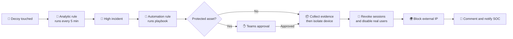

# 🍯 Honeytoken Isolation Playbook

A Microsoft Sentinel SOAR playbook that automatically contains any device, account or IP that touches a decoy. Nobody legitimate should ever use a honeytoken account or connect to a honeypot server, so every hit is treated as a true positive and contained in minutes, before an attacker or autonomous agent can move further.

> ⚠️ **Note:** Automated containment is the first response, not the investigation. Every incident this playbook handles should still be investigated to find how the attacker got in and what else they touched.

---

## 🔄 How It Works



| Step | Action | Automatic? |
|---|---|---|
| 1 | Collect an investigation package from the source device | ✅ |
| 2 | Isolate the source device in Defender | ✅ workstations · ✋ approval for protected assets |
| 3 | Revoke sessions and disable real users seen on the source device | ✅ standard users · ✋ approval for protected accounts |
| 4 | Block external source IPs (Conditional Access + Defender indicator) | ✅ never internal or protected IPs |
| 5 | Comment the incident and notify the SOC in Teams | ✅ |

---

## 🧰 Prerequisites

- Microsoft Sentinel with the **Microsoft Defender XDR** connector (Device* tables) and **Microsoft Entra ID** connector (`SigninLogs`, `AADNonInteractiveUserSignInLogs`)
- Defender for Endpoint P2 on the devices to be isolated
- Entra ID P1 or P2 for Conditional Access
- A Teams channel for SOC notifications and approvals
- Honeytokens and honeypots already deployed (decoy Entra account, bait credentials, OpenCanary or Thinkst Canary server)

---

## 📋 Watchlists

Keeping decoys and exceptions in watchlists means you can add or change them without editing rules or the playbook.

**🍯 `Honeytokens`** (SearchKey: `Value`)

| Type | Value | Description |
|---|---|---|
| Account | svc-backup-admin@yourdomain.com | Entra decoy, bait creds in fake .env on FS share |
| Device | hou-fs03 | OpenCanary decoy file server |

**🛡️ `ProtectedAssets`** (SearchKey: `Value`)

| Type | Value | Description |
|---|---|---|
| Device | dc01 | Domain controller, approval required before isolation |
| Account | admin@yourdomain.com | Privileged admin, approval required before disabling |
| IP | 203.0.113.10 | Corporate egress IP, never blocked |

Add your corporate egress IPs, VPN gateways, scanners and your own admin IP to `ProtectedAssets` before turning the playbook on. Otherwise a test or a scanner can block your own access.

---

## 🔎 Analytic Rules

Both rules resolve the source IP to a Defender device using `DeviceNetworkInfo`, and pass the device ID and recently active users to the playbook as custom details.

### 🔑 Rule A: Honeytoken Account Used

Any sign-in or logon attempt, successful or not, with a decoy account.

```kql
let Lookback = 10m;
let HoneyAccounts = toscalar(_GetWatchlist("Honeytokens")
    | where Type == "Account"
    | summarize make_list(tolower(tostring(SearchKey))));
let HoneyNames = toscalar(_GetWatchlist("Honeytokens")
    | where Type == "Account"
    | summarize make_list(tolower(tostring(split(tostring(SearchKey), "@")[0]))));
let IpToDevice = DeviceNetworkInfo
    | where TimeGenerated > ago(1d)
    | mv-expand IP = parse_json(IPAddresses)
    | extend IPAddress = tostring(IP.IPAddress)
    | where isnotempty(IPAddress)
    | summarize arg_max(TimeGenerated, DeviceId, DeviceName) by IPAddress
    | project IPAddress, ResolvedDeviceId = DeviceId, ResolvedDeviceName = DeviceName;
let RecentUsers = DeviceProcessEvents
    | where TimeGenerated > ago(4h)
    | where isnotempty(AccountUpn)
    | summarize SourceUsers = make_set(tolower(AccountUpn), 5) by DeviceId;
union
    (SigninLogs
        | where TimeGenerated > ago(Lookback)
        | where tolower(UserPrincipalName) in (HoneyAccounts)
        | project TimeGenerated, Channel = "Entra sign-in", HoneyAccount = UserPrincipalName,
                  SourceIP = IPAddress, SourceHost = tostring(DeviceDetail.displayName),
                  Result = tostring(ResultType), Detail = AppDisplayName),
    (AADNonInteractiveUserSignInLogs
        | where TimeGenerated > ago(Lookback)
        | where tolower(UserPrincipalName) in (HoneyAccounts)
        | project TimeGenerated, Channel = "Entra non-interactive", HoneyAccount = UserPrincipalName,
                  SourceIP = IPAddress, SourceHost = tostring(parse_json(DeviceDetail).displayName),
                  Result = tostring(ResultType), Detail = AppDisplayName),
    (DeviceLogonEvents
        | where TimeGenerated > ago(Lookback)
        | where tolower(AccountName) in (HoneyNames)
        | extend IsLocal = LogonType in ("Interactive", "CachedInteractive", "Unlock")
        | project TimeGenerated, Channel = "Device logon", HoneyAccount = AccountName,
                  SourceIP = RemoteIP,
                  SourceHost = iff(IsLocal, DeviceName, RemoteDeviceName),
                  LocalDeviceId = iff(IsLocal, DeviceId, ""),
                  Result = ActionType, Detail = strcat(LogonType, " on ", DeviceName))
| join kind=leftouter IpToDevice on $left.SourceIP == $right.IPAddress
| extend SourceHost = coalesce(SourceHost, ResolvedDeviceName),
         SourceDeviceId = coalesce(LocalDeviceId, ResolvedDeviceId)
| join kind=leftouter RecentUsers on $left.SourceDeviceId == $right.DeviceId
| summarize Attempts = count(),
            FirstSeen = min(TimeGenerated),
            LastSeen = max(TimeGenerated),
            Channels = make_set(Channel, 5),
            Results = make_set(Result, 5),
            Details = make_set(Detail, 5),
            SourceUsers = take_any(SourceUsers)
         by HoneyAccount, SourceIP, SourceHost, SourceDeviceId
```

### 🖥️ Rule B: Honeypot Device Touched

Any inbound connection, blocked connection or logon attempt against a decoy server.

```kql
let Lookback = 10m;
let Allowlist = dynamic([]);   // approved scanner IPs
let HoneyHosts = toscalar(_GetWatchlist("Honeytokens")
    | where Type == "Device"
    | summarize make_list(tolower(tostring(SearchKey))));
let IpToDevice = DeviceNetworkInfo
    | where TimeGenerated > ago(1d)
    | mv-expand IP = parse_json(IPAddresses)
    | extend IPAddress = tostring(IP.IPAddress)
    | where isnotempty(IPAddress)
    | summarize arg_max(TimeGenerated, DeviceId, DeviceName) by IPAddress
    | project IPAddress, SourceDeviceId = DeviceId, SourceHost = DeviceName;
let RecentUsers = DeviceProcessEvents
    | where TimeGenerated > ago(4h)
    | where isnotempty(AccountUpn)
    | summarize SourceUsers = make_set(tolower(AccountUpn), 5) by DeviceId;
union
    (DeviceNetworkEvents
        | where TimeGenerated > ago(Lookback)
        | where ActionType == "InboundConnectionAccepted"
        | extend DecoyHost = tolower(tostring(split(DeviceName, ".")[0]))
        | where DecoyHost in (HoneyHosts)
        | project TimeGenerated, Channel = "Inbound connection", DecoyHost,
                  SourceIP = RemoteIP, Detail = strcat("Port ", tostring(LocalPort))),
    (DeviceEvents
        | where TimeGenerated > ago(Lookback)
        | where ActionType == "FirewallInboundConnectionBlocked"
        | extend DecoyHost = tolower(tostring(split(DeviceName, ".")[0]))
        | where DecoyHost in (HoneyHosts)
        | project TimeGenerated, Channel = "Blocked inbound", DecoyHost,
                  SourceIP = RemoteIP, Detail = strcat("Port ", tostring(LocalPort))),
    (DeviceLogonEvents
        | where TimeGenerated > ago(Lookback)
        | extend DecoyHost = tolower(tostring(split(DeviceName, ".")[0]))
        | where DecoyHost in (HoneyHosts)
        | project TimeGenerated, Channel = "Logon attempt", DecoyHost,
                  SourceIP = RemoteIP, Detail = strcat(ActionType, " as ", AccountName, " (", LogonType, ")"))
| where isnotempty(SourceIP) and SourceIP !in (Allowlist) and SourceIP !in ("127.0.0.1", "::1")
| join kind=leftouter IpToDevice on $left.SourceIP == $right.IPAddress
| join kind=leftouter RecentUsers on $left.SourceDeviceId == $right.DeviceId
| summarize Hits = count(),
            FirstSeen = min(TimeGenerated),
            LastSeen = max(TimeGenerated),
            Channels = make_set(Channel, 5),
            Details = make_set(Detail, 10),
            SourceUsers = take_any(SourceUsers)
         by DecoyHost, SourceIP, SourceHost, SourceDeviceId
```

**🐦 OpenCanary leg (optional):** if the honeypot forwards OpenCanary JSON to Syslog, add this as another leg inside the `union`:

```kql
    (Syslog
        | where TimeGenerated > ago(Lookback)
        | where SyslogMessage has "opencanary" or ProcessName has "opencanary"
        | extend J = parse_json(extract(@"(\{.*\})", 1, SyslogMessage))
        | where isnotempty(tostring(J.src_host))
        | extend DecoyHost = tolower(tostring(split(Computer, ".")[0]))
        | project TimeGenerated, Channel = "OpenCanary", DecoyHost,
                  SourceIP = tostring(J.src_host),
                  Detail = strcat("Port ", tostring(J.dst_port), " · logtype ", tostring(J.logtype),
                                  " · user ", tostring(J.logdata.USERNAME)))
```

### ⚙️ Rule Settings

| Setting | Rule A | Rule B |
|---|---|---|
| Name | 🍯 Honeytoken Account Used | 🍯 Honeypot Device Touched |
| Severity | High | High |
| Run every / Look back | 5 min / 10 min | 5 min / 10 min |
| Event grouping | One alert per result | One alert per result |
| Entity: Account | `HoneyAccount` (FullName) | — |
| Entity: Host | `SourceHost` (HostName) | `SourceHost` (HostName) |
| Entity: IP | `SourceIP` (Address) | `SourceIP` (Address) |
| Custom details | `SourceDeviceId`, `SourceUsers`, `Channels`, `Results` | `SourceDeviceId`, `SourceUsers`, `DecoyHost`, `Channels` |
| Incident grouping | Group by IP and Host within 1 hour | Group by IP and Host within 1 hour |

The 10-minute lookback with a 5-minute schedule means the same event can be seen twice. Incident grouping merges those into one incident, and the playbook skips devices that are already isolated.

---

## 🤖 Playbook Steps

Logic App **SOAR-Honeytoken-Isolate**, triggered by **Microsoft Sentinel incident**, with a **system-assigned managed identity**. Defender and Graph calls are HTTP actions authenticated with the managed identity.

**1. 🚀 Start**
- Get the incident's Hosts, Accounts and IPs, and parse the alert custom details (`SourceDeviceId`, `SourceUsers`).
- Add the incident tag `Honeytoken`, set severity to High, and comment `Playbook started`.

**2. 🖥️ Contain each source host**
- Skip it if it's empty or in `Honeytokens`, since you don't isolate the decoy itself.
- Resolve the Defender machine ID from `SourceDeviceId`, or look it up by name:
  `GET https://api.securitycenter.microsoft.com/api/machines?$filter=computerDnsName eq '{host}'`
- Skip it if it's already isolated (`GET /api/machines/{id}/machineactions`, latest Isolate action succeeded).
- If the host is in `ProtectedAssets`, post a Teams adaptive card (**Post adaptive card and wait for a response**, 30-minute timeout) and continue only if it's approved.
- Collect evidence first:
  `POST /api/machines/{id}/collectInvestigationPackage` with body `{"Comment": "Honeytoken incident {incidentNumber}"}`
- Isolate:
  `POST /api/machines/{id}/isolate` with body `{"Comment": "Honeytoken incident {incidentNumber}", "IsolationType": "Full"}`

**3. 👤 Contain real users on the source device**
- Loop over `SourceUsers`, skipping anything in `Honeytokens`.
- Revoke sessions: `POST https://graph.microsoft.com/v1.0/users/{upn}/revokeSignInSessions`
- Disable: `PATCH https://graph.microsoft.com/v1.0/users/{upn}` with body `{"accountEnabled": false}`
- If the account is in `ProtectedAssets`, revoke sessions automatically but require Teams approval before disabling.

**4. 🌍 Block external source IPs**
- Skip private ranges (10/8, 172.16/12, 192.168/16) and anything in `ProtectedAssets`. Isolating the device already handles internal sources.
- **Entra:** add the IP to the named location **SOAR Blocked IPs**, which a Conditional Access policy blocks from all sign-ins. Graph replaces the whole list, so `GET` the named location first, append the new `/32`, then:
  `PATCH https://graph.microsoft.com/v1.0/identity/conditionalAccess/namedLocations/{id}`
- **Defender:** stop any device from connecting out to the IP for 72 hours:
  `POST https://api.securitycenter.microsoft.com/api/indicators` with body
  `{"indicatorValue": "{ip}", "indicatorType": "IpAddress", "action": "Block", "severity": "High", "title": "Honeytoken source {ip}", "description": "Incident {incidentNumber}", "expirationTime": "@{addHours(utcNow(), 72)}"}`

**5. 💬 Wrap up**
- Comment the incident with every action taken and skipped, then post a summary to the SOC Teams channel.
- Leave the incident **Active** for an analyst to investigate. Don't auto-close it.

**⚠️ Error handling:** set **Configure run after → has failed** on each containment action. A failure adds an incident comment and a Teams alert, so a failed isolation is never silent.

---

## 🔐 Permissions

**Managed identity API permissions**

| API | Permissions | Used For |
|---|---|---|
| WindowsDefenderATP | `Machine.Read.All`, `Machine.Isolate`, `Machine.CollectForensics`, `Ti.ReadWrite.All` | Device lookup, isolation, evidence, IP indicators |
| Microsoft Graph | `User.Read.All`, `User.RevokeSessions.All`, `User.EnableDisableAccount.All` | Revoke sessions, disable users |
| Microsoft Graph | `Policy.Read.All`, `Policy.ReadWrite.ConditionalAccess` | Update the blocked IP named location |

Grant them with PowerShell, since managed identities have no API permissions page:

```powershell
Connect-MgGraph -Scopes "AppRoleAssignment.ReadWrite.All", "Application.Read.All"

$mi    = Get-MgServicePrincipal -Filter "displayName eq 'SOAR-Honeytoken-Isolate'"
$graph = Get-MgServicePrincipal -Filter "appId eq '00000003-0000-0000-c000-000000000000'"
$mde   = Get-MgServicePrincipal -Filter "appId eq 'fc780465-2017-40d4-a0c5-307022471b92'"

$grants = @{
    $graph = "User.Read.All", "User.RevokeSessions.All", "User.EnableDisableAccount.All",
             "Policy.Read.All", "Policy.ReadWrite.ConditionalAccess"
    $mde   = "Machine.Read.All", "Machine.Isolate", "Machine.CollectForensics", "Ti.ReadWrite.All"
}

foreach ($api in $grants.Keys) {
    foreach ($perm in $grants[$api]) {
        $role = $api.AppRoles | Where-Object Value -eq $perm
        New-MgServicePrincipalAppRoleAssignment -ServicePrincipalId $mi.Id `
            -PrincipalId $mi.Id -ResourceId $api.Id -AppRoleId $role.Id
    }
}
```

**Azure roles**
- The managed identity gets **Microsoft Sentinel Responder** on the Sentinel resource group, so it can comment and tag incidents.
- The Azure Security Insights service principal gets **Microsoft Sentinel Automation Contributor** on the playbook's resource group, so automation rules can run it. **Settings → Playbook permissions** in Sentinel does this for you.

Graph can't disable accounts that hold privileged directory roles without additional admin roles. That's another reason privileged accounts go through approval in `ProtectedAssets`.

---

## 🧷 Automation Rule

| Setting | Value |
|---|---|
| Trigger | When incident is created |
| Condition | Analytic rule name contains `Honeytoken` or `Honeypot` |
| Action | Run playbook **SOAR-Honeytoken-Isolate** |
| Order | 1 |

---

## 🧪 Testing

Test in the lab first. Add your own home or admin IP to `ProtectedAssets`, so the Conditional Access block can't lock you out.

1. **🖥️ Honeypot:** from windows-vm, run `Test-NetConnection hou-fs03 -Port 445`. Within about 15 minutes, expect a Rule B incident, an investigation package, and windows-vm isolated.
2. **🔑 Honeytoken:** from windows-vm, try signing in as the decoy account with a wrong password. Expect a Rule A incident. The VM's public egress IP gets blocked unless it's in `ProtectedAssets`.
3. **✋ Approval path:** add windows-vm to `ProtectedAssets` and repeat step 1. Expect a Teams card, and no isolation until you approve.
4. **✅ Check:** the incident comments should list every action, and the Teams channel should get the summary.
5. **↩️ Release:** follow the rollback steps below and confirm windows-vm is reachable again.

Isolation cuts RDP to the VM. Release it from the Defender portal, not from inside the VM.

---

## ↩️ Rollback

| Action | How to Undo |
|---|---|
| Device isolation | Defender portal → device → **Release from isolation**, or `POST /api/machines/{id}/unisolate` |
| Disabled user | `PATCH /users/{upn}` with body `{"accountEnabled": true}`, then reset the password |
| Defender IP indicator | Expires after 72 hours, or delete it under **Settings → Endpoints → Indicators** |
| Conditional Access block | Remove the IP from the **SOAR Blocked IPs** named location |

Named locations don't expire. Review **SOAR Blocked IPs** weekly and remove stale entries.

---

## 📝 Notes

- 🧭 **Source resolution:** the playbook can only isolate devices onboarded to Defender. An external attacker with no device in your tenant gets IP blocks only.
- 🔁 **Rotating IPs:** an attacker spraying from many IPs will produce many blocks. Pair this with the Distributed & Low-and-Slow Sign-Ins panel, and focus on protecting the targeted accounts.
- 🔒 **Keep decoys believable:** don't list honeytokens in shared docs or wikis. Limit the watchlists to SOC staff.
- 🧹 **Rotate bait:** change bait locations and decoy names every few months so they stay believable.
