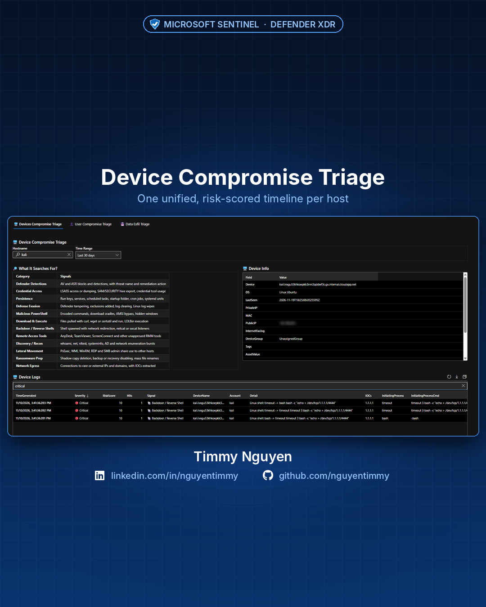

# 🛡️ Sentinel Workbooks

Everything lives in one Microsoft Sentinel / Defender XDR workbook: the **[📊 Security Operations Workbook](Security%20Operations%20Workbook/README.md)**. Fleet-wide dashboards surface something worth a look, and the Incident Response Dashboard in the same workbook investigates it, so there's no switching between workbooks.

> ⚠️ This workbook does not replace alert triage. Alerts and incidents should still be investigated for a deeper investigation.

---

## 🗺️ The tabs at a glance

| Tab | Question it answers |
| --- | --- |
| 🖥️ **Detection Dashboard** | *What's alerting, and which incidents are open?* |
| 🛡️ **EDR Dashboard** | *What did Defender catch or block, and is the sensor reporting?* |
| 🔍 **Incident Response Dashboard** | *What happened to this device or user, before and after compromise?* |
| 📊 **KPI Metrics Dashboard** | *How fast and how accurately is the SOC responding?* |
| 🎯 **Threat Hunt Dashboard** | *What's happening that nothing caught yet?* |
| 📡 **SIEM Dashboard** | *Is the data we detect on still arriving, on time and within budget?* |

---

## 🔄 The workflow

```
🖥️ Detection · 🛡️ EDR · 🎯 Threat Hunt
   Fleet-wide — something surfaces
              ↓  gives you a device or user
🔍 Incident Response Dashboard
   Risk-scored device, user + data exfil timeline — confirms and scopes
              ↓  need every raw event?
   Defender XDR device timeline (unfiltered, exportable)

📊 KPI Metrics — how it was handled   ·   📡 SIEM — is the data still arriving?
```

---

## 🧭 Quick reference — where do I look?

| Situation | Tab |
| --- | --- |
| Morning check, nothing specific | 🖥️ Detection Dashboard |
| An alert fired on a device | 🔍 Incident Response Dashboard (Device Investigation) |
| A user reported a phishing email | 🔍 Incident Response Dashboard (User Investigation) |
| Suspected data theft by a user or device | 🔍 Incident Response Dashboard (Data Exfil) |
| Checking whether protection is disabled anywhere | 🛡️ EDR Dashboard |
| Deciding which ASR rules to move from Audit to Block | 🛡️ EDR Dashboard |
| Reporting on response times or analyst workload | 📊 KPI Metrics Dashboard |
| A connector, agent or table went quiet, or ingestion cost jumped | 📡 SIEM Dashboard |
| Need every raw event for the incident report | Defender XDR device timeline |

---

## 📊 Visualization of the Dashboard

Here's an example of the [Device Investigation](Security%20Operations%20Workbook/Incident%20Response%20Dashboard/Device%20Investigation.md) dashboard in action:


