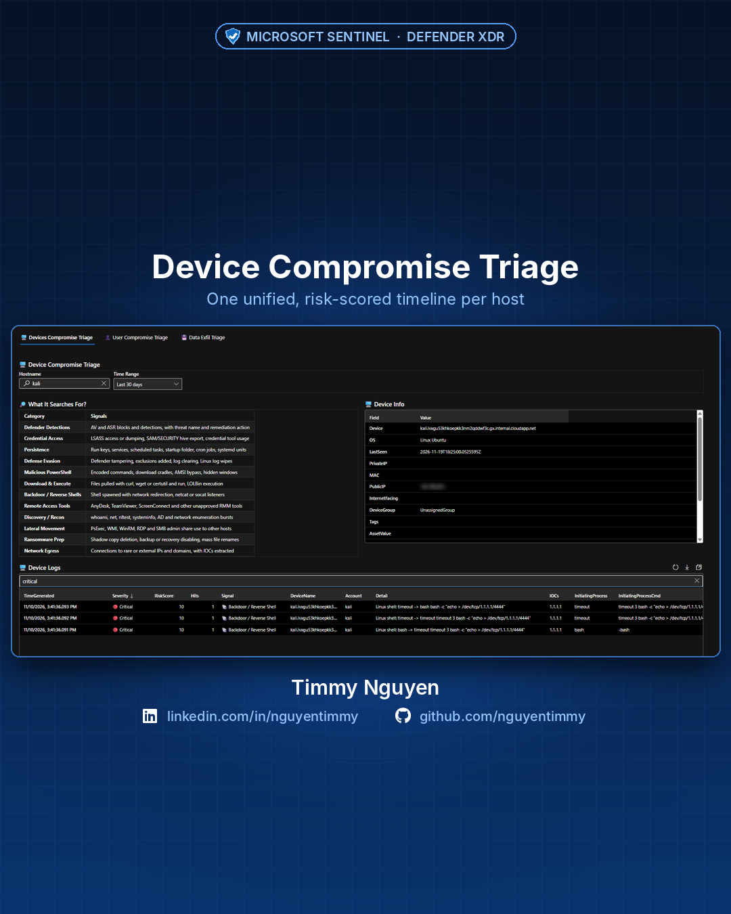

# 📊 Security Operations Workbook — How These Fit Together

Six tabs inside one Sentinel workbook. They're not alternatives to each other — together they cover the full loop of detection, prevention, hunting, investigation, and measuring how well the SOC responds.

> **Disclaimer:** This workbook does not replace alert triage. Alerts and incidents should still be investigated — the workbook supports deeper investigation.

---

## 🗺️ The six tabs at a glance

| Tab | Mode | Question it answers |
| --- | --- | --- |
| 🖥️ **Detection Dashboard** | Passive, continuous | *What's alerting, how bad is it, and where?* |
| 🛡️ **EDR Dashboard** (AV + ASR) | Passive, continuous | *What did Defender catch or block — did it clean up, and is the sensor even reporting?* |
| 🔍 **Incident Response Dashboard** | On-demand, one entity | *What happened to this device or user, before and after compromise?* |
| 📊 **KPI Metrics** | Retrospective | *How fast and how accurately is the SOC responding?* |
| 🎯 **Threat Hunting** | Active, daily | *What's happening that nothing caught yet?* |
| 📡 **SIEM Dashboard** | Passive, continuous | *Is the data we detect on still arriving, on time and within budget?* |

Panels are parameterized — **Hostname** + **Time Range** (plus **User** where it applies). Leave the filters empty for a fleet-wide sweep, or fill them in to scope to one device or user.

---

## 🔄 How they relate

```
🖥️ Detection Dashboard  ⎫
                         ⎬  passive signal — what fired and what protection stopped
🛡️ EDR Dashboard        ⎭

🎯 Threat Hunting      ─  active search — finds what policy and signature can't

                All three converge here:
                        ↓
         A device or user shows up repeatedly, or a hunt hit
         looks worth escalating
                        ↓
        🔍 Incident Response Dashboard (Device / User Investigation, Data Exfil)

📊 KPI Metrics         ─  looks back at how all of the above was handled

📡 SIEM Dashboard       ─  underneath everything: is the data still arriving?
```

---

## 🖥️ Detection Dashboard

**Purpose: the at-a-glance view of everything that alerted, and of the incidents (cases) those alerts became.** Two groups in the same tab: [Alert Dashboard](Detection%20Dashboard/Alert%20Dashboard.md) and [Incident Dashboard](Detection%20Dashboard/Incident%20Dashboard.md).

### 🚨 Alert Dashboard
- **Alerts** — searchable alert table with status, severity, device, account, files, commands, and IOCs
- **Detection by Severity + Alert Status** — how bad, and how much is still open
- **Detections by Technique + Alerts Over Time by Severity** — what attackers are attempting, and when
- **Top 10 Alert Types** — the noisiest detections, with severity and product
- **Processes on Device** — process activity over time for the selected host

### 🗂️ Incident Dashboard
- **Incident Summary** — open, unassigned, open High, SLA breached, MTTA, MTTR and true positive rate
- **Open Incident Queue** — every open incident with owner, age and ⏰ SLA / 🙋 unassigned / 💤 stale flags
- **Severity, Status and Classification** — how bad, how much is still open, and how cases are being closed
- **Top 10 Recurring Incidents** — titles that keep coming back, with their noise rate
- **Most Involved Entities** — hosts, accounts and IPs that appear across the most incidents

> 💡 Start here every morning. A rising count of **New** alerts or a spike in one technique tells you where to look before anything else.

---

## 🛡️ EDR Dashboard

**Purpose: confirm what Defender caught and blocked — and whether the sensors can be trusted.** Two groups: [AV Dashboard](EDR%20Dashboard/AV%20Dashboard.md) and [ASR Dashboard](EDR%20Dashboard/ASR%20Dashboard.md).

### 🦠 AV
- **Antivirus Detections** — every detection risk-scored by remediation status, whether it was running, threat family, and path
- **AV Overview, Severity, Over Time, Top Threats** — the trend and volume view
- **EDR Evasions** — BYOVD, EDR-killer tools, EDR process/service kills, Defender tampering, Safe Mode abuse, log tampering
- **Defender Health** — sensors not reporting, with tamper protection state
- **Sensor Coverage + Onboarding** — active vs. inactive sensors and onboarded vs. not

### 🧱 ASR
- **ASR Detections** — every hit with rule, Block vs. Audit, device, file, and initiating process
- **Hits by Rule, Block vs. Audit, Severity, Over Time** — which rules fire and how hard
- **Top Triggering Processes + Top Devices** — attack tooling vs. legitimate apps needing an exclusion
- **Audit-Only Rules** — rules that have never blocked, ranked as candidates to move from Audit to Block

> 💡 A detection marked **Not Remediated** is worth more attention than three clean removals. And check sensor health first: a device that isn't reporting looks identical to a clean one.

---

## 🔍 Incident Response Dashboard

**Purpose: on-demand investigation of one device or user, before, during and after a compromise.** Pick an entity and a time range and get one risk-scored, chronological timeline, with no query editing. Pages: [Device Investigation](Incident%20Response%20Dashboard/Device%20Investigation.md), [User Investigation](Incident%20Response%20Dashboard/User%20Investigation.md) and [Data Exfil](Incident%20Response%20Dashboard/Data%20Exfil.md).

Every Device and User row is tagged with a **Phase**:

| Phase | Answers |
| --- | --- |
| 1️⃣ Pre-Compromise | Was this entity targeted? Phishing, spray, brute force, exposed ports, risky downloads, blocked threats |
| 2️⃣ Initial Access | Did the attack get in? First execution, risky sign-ins, clicked phishing, token replay |
| 3️⃣ Post-Compromise | What happened next? Persistence, credential theft, lateral movement, mailbox abuse, exfil |

- **🖥️ Device Investigation** — targeting and attempts, initial access, persistence, credential access, evasion, ransomware prep, discovery, lateral movement, egress, backdoors, remote tools and Defender detections. Context panels: Device Info, Processes, Details, IOC
- **👤 User Investigation** — phishing clicks, token replay, risky and unusual sign-ins, malicious IPs, MFA and password changes, roles, OAuth consent, mailbox rules, delegation and export. Panels: Sign-In Activity, Phishing Received, Containment Status, User Info, Apps, IPs & Locations, Devices
- **📤 Data Exfil** — file-sharing and paste uploads, exfil tooling, mass archiving, removable media, bulk cloud download, outbound attachments, forwarding rules and connection fan-out

> 💡 **The pages pivot into each other.** A risky sign-in names a device; a compromised endpoint names a logged-in account; either one showing staging leads to Data Exfil. Start with whichever entity you have and follow the trail.



---

## 📊 KPI Metrics

**Purpose: SOC optimization — measure how fast and how accurately incidents are handled.** Full KQL: [KPI Metrics Dashboard](KPI%20Metrics%20Dashboard/KPI%20Metrics%20Dashboard.md)

- **MTTD / MTTA / MTTR** — mean time to detect, acknowledge, and resolve, with trends and breakdowns by severity
- **Incidents by Analyst + Status** — workload and backlog per analyst
- **Classification + TP / BP / FP Rates** — how much alerting is real, benign, or noise
- **Created vs. Closed + Tuning Candidates** — whether the backlog is growing, and which detections are mostly noise

> 💡 A high false-positive rate on one detection is a tuning task, not just a metric — feed it back into the detection rule or the hunt's exclusions.

---

## 🎯 Threat Hunting

**Purpose: find what Detection Dashboard and EDR Dashboard structurally can't.** Full KQL: [Daily Hunts](Threat%20Hunt%20Dashboard/Daily%20Hunts.md) and [AI Autonomous Threats Hunts](Threat%20Hunt%20Dashboard/AI%20Autonomous%20Threats%20Hunts.md)

Proactive, technique-level daily hunts, split by entity:

- **💻 Device Hunts** — HTTP + Tor downloads, LOLBin abuse, remote file drops, sensitive config downloads, webshells, EDR evasions, external PowerShell downloads, rare service processes, unapproved remote access tools
- **👤 User Hunts** — malicious attachments, MFA spamming, sign-ins from known-malicious IPs

Unlike the other tabs, nothing here fires on its own. It's only as current as the last time someone ran it.

> 💡 If a hunt hasn't been run in its expected cadence window, treat that gap itself as a coverage risk, not just an empty result.

---

## 📡 SIEM Dashboard

**Purpose: confirm the SIEM itself is healthy, because a quiet table means quiet detections.** Full KQL: [SIEM Dashboard](SIEM%20Dashboard/SIEM%20Dashboard.md)

- **Ingestion Summary, Daily Ingestion, Top Tables** — how much data is coming in, from where, and what it costs
- **Ingestion Anomalies + Top Noisy Sources** — sudden spikes or drops, and which sources drive volume
- **Last Seen per Table + Silent Sources** — tables, hosts and appliances that stopped sending
- **Connector Health + Agent Heartbeat + Ingestion Latency** — whether collection is working and on time
- **Rule & Automation Failures** — analytics and automation rules that failed

> 💡 Check it when detections go unusually quiet, or once a day alongside Detection Dashboard.

---

## ⚖️ Passive vs. active — why both are necessary

| | Detection / EDR Dashboard | Threat Hunting |
| --- | --- | --- |
| Trigger | Automatic — rule, policy, or signature match | Manual — analyst runs the query |
| Cadence | Continuous, real-time | Daily |
| Coverage | Known techniques, policy-defined | Technique-level behavior, no signature required |
| Confidence | High — already confirmed by the engine | Variable — candidate for investigation |
| Blind spot | Anything with no matching rule or signature | Nothing runs itself — depends on hunt cadence being kept |

Neither replaces the other. Alerts and EDR tell you protection is working; Threat Hunting tells you what protection was never going to catch in the first place.

---

## 🧭 Quick reference — where do I look?

| Situation | Tab |
| --- | --- |
| Morning check — what's alerting? | 🖥️ Detection Dashboard (Alert Dashboard) |
| What cases are open, unassigned or breaching SLA? | 🖥️ Detection Dashboard (Incident Dashboard) |
| Daily proactive sweep | 🎯 Threat Hunting |
| A detection came back unremediated | 🛡️ EDR Dashboard (AV) → escalate if unresolved |
| Checking whether a sensor is down or tamper protection is off | 🛡️ EDR Dashboard (Defender Health) |
| Same ASR rule firing across multiple devices | 🛡️ EDR Dashboard (ASR) → new campaign vs. FP |
| Deciding which ASR rules to move from Audit to Block | 🛡️ EDR Dashboard (Audit-Only Rules) |
| A user is getting MFA-bombed or signed in from a bad IP | 🎯 Threat Hunting (User Hunts) |
| Reporting on response times or analyst workload | 📊 KPI Metrics |
| A connector, agent or table went quiet, or ingestion cost jumped | 📡 SIEM Dashboard |
| An alert fired on a device, or a user reported phishing | 🔍 Incident Response Dashboard |
| Suspected data theft by a user or device | 🔍 Incident Response Dashboard (Data Exfil) |

---

## 📌 Notes

Exclusion lists, trusted-domain lists, and the `KnownProcesses` watchlist are environment-specific — keep them current as new sanctioned tooling gets deployed, or hunts will drown in known-good noise.

Tamper protection can't be read directly in Sentinel (the `DeviceTvm*` tables are Defender XDR only), so Defender Health infers it from registry changes — a device that never changed the setting shows **Unknown**.

This workbook surfaces activity for human review; it doesn't take action on its own. Pair anything high-fidelity here with a scheduled analytics rule if it should page someone instead of waiting to be glanced at.